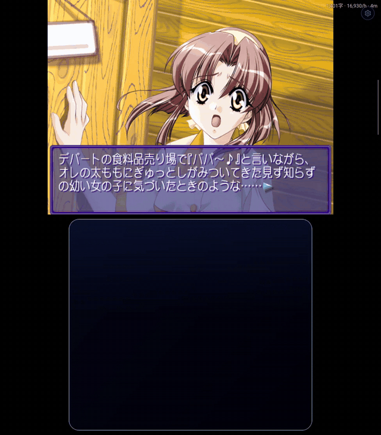
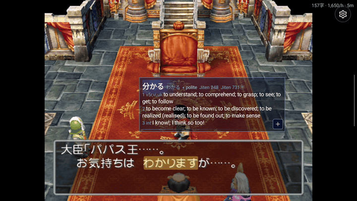
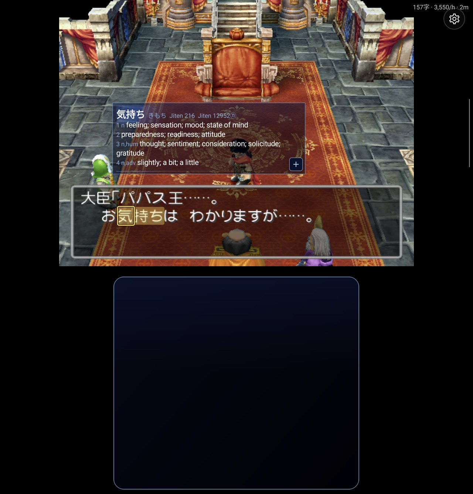
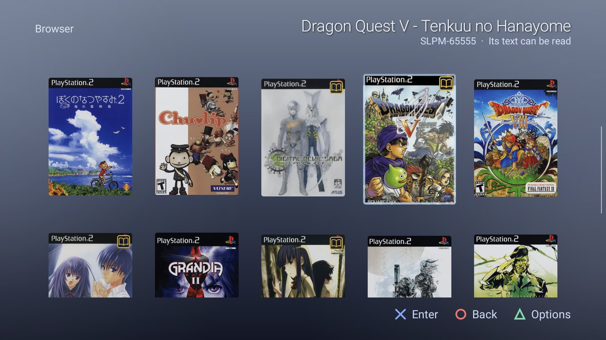
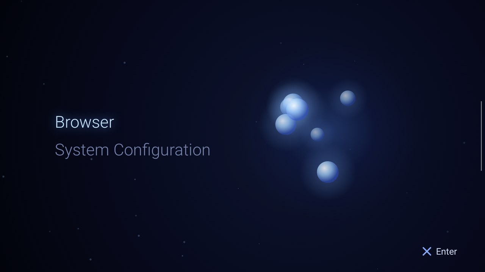

# ARMSX2 Reader

Read Japanese PS2 games on Android like a visual novel in a browser with Yomitan: move the
cursor onto a word in the game's own text and its dictionary entry opens. Make Anki cards,
keep a backlog and reading statistics.

The Windows version is [PCSX2 Reader](https://github.com/sommepo/pcsx2-reader).

<table>
  <tr>
    <td width="50%"> Two screens: the lower one is a trackpad</td>
    <td width="50%"> One screen: touch a word</td>
  </tr>
</table>

> A fork of [ARMSX2](https://github.com/ARMSX2/ARMSX2) v6. It is not ARMSX2: please report
> nothing about it to the ARMSX2 or PCSX2 projects. ARMSX2's README is
> [README.armsx2.md](README.armsx2.md). The reading layer is AI-written.

## Features

- **Look up words in the game's text.** Move the cursor onto a word (with the controller, or
  on a two-screen handheld with the lower screen as a trackpad). Touching a word works too.
  Uses Yomitan dictionaries.
- **Anki cards** in AnkiDroid, with the sentence and a picture of the scene.
- **Backlog and reading statistics.**
- **Next Choice**: run a visual novel at full speed to its next choice.
- **The PS2's own menu** as the game list. **PS2 Menu** in the app's library switches it back
  on.
- **CRT picture** (optional, in Reader settings).

<table>
  <tr>
    <td width="50%"> Cursor lookup</td>
    <td width="50%"> The Browser: a book marks a supported game</td>
  </tr>
  <tr>
    <td> CRT picture</td>
    <td> The PS2 menu</td>
  </tr>
</table>

## Get it

Download `ARMSX2Reader-<version>-android.apk` from the [releases](../../releases) (arm64). It
installs beside ARMSX2. You need your own PS2 BIOS and games.

## Game scripts

A game is read through a **game script**: a small Lua file that tells the app where the game
keeps its text. The app installs them from the list in
[PCSX2 Reader's repository](https://github.com/sommepo/pcsx2-reader#game-scripts), which has the
supported games: **System Configuration → Game Scripts**. New games appear there without an
app update. You can also install a script from a file.

## Building

See [AGENTS.md](AGENTS.md).

## Licence

GPL-3.0-or-later, as ARMSX2 and PCSX2 ([COPYING.GPLv3](COPYING.GPLv3)).
