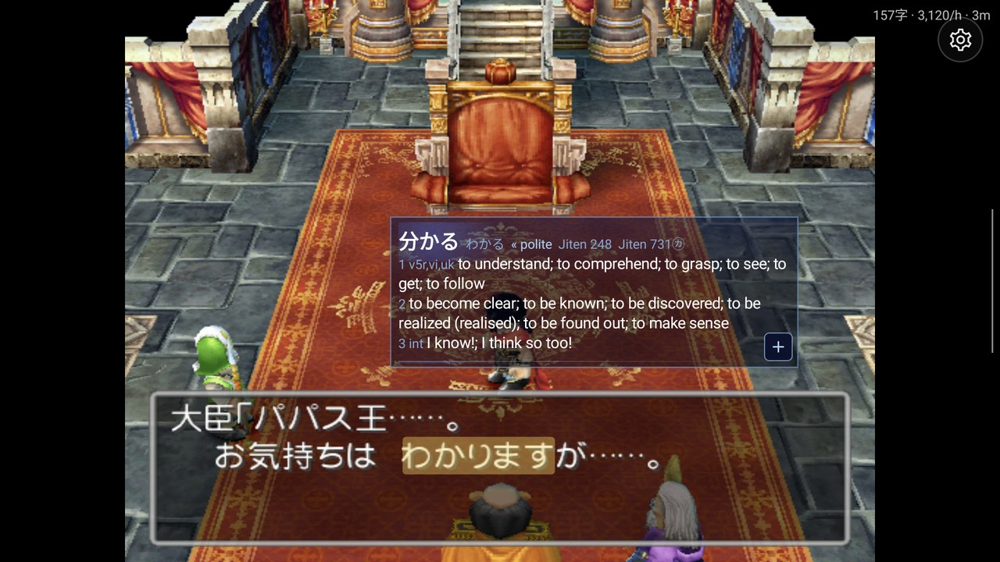
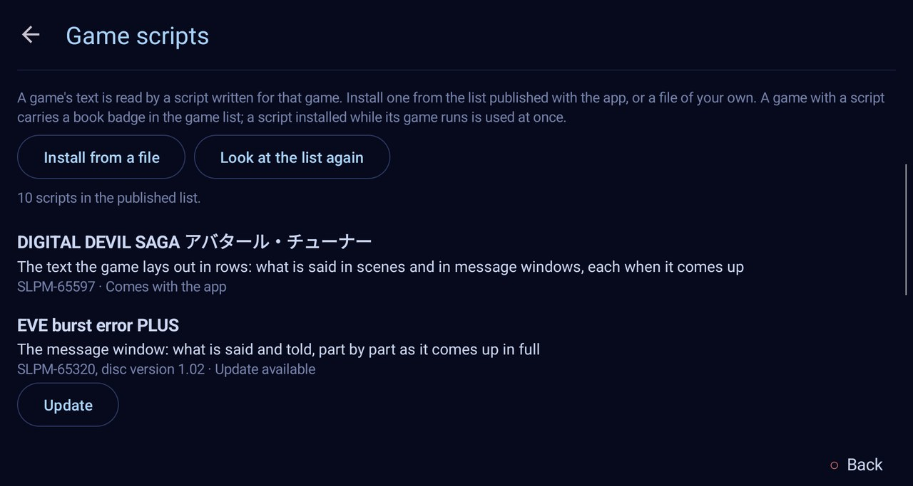

# ARMSX2 Reader

Read Japanese PlayStation 2 games on an Android handheld the way you read a visual novel in a
browser with Yomitan: point at a word **in the game's own text** and its dictionary entry
opens, make an Anki card of it, and your reading is counted. Nothing of the emulator is drawn
over the game.

Its desktop sibling is [PCSX2 Reader](https://github.com/sommepo/pcsx2-reader) (Windows), which
runs the same game scripts.

> ARMSX2 Reader is a fork of the [ARMSX2](https://github.com/ARMSX2/ARMSX2) emulator (v6, itself
> built on PCSX2) with a reading layer on top. **It is not ARMSX2 and is not supported by the
> ARMSX2 or PCSX2 projects**: please report nothing about it there. ARMSX2's own README is
> [README.armsx2.md](README.armsx2.md). The reading layer's code is AI-written; nothing from
> here is to be sent upstream.

<table>
  <tr>
    <td width="50%"> <b>Two screens:</b> the lower one is the cursor's trackpad.</td>
    <td width="50%"> <b>One screen:</b> touch the word.</td>
  </tr>
</table>

ドラゴンクエストV 天空の花嫁 on an AYN Thor, with the dictionary JMdict.

## What it does

- **Look words up in the game's picture.** A word in a text box is real text: move the
  reader's cursor onto it with the controller (on a two-screen handheld the second screen is
  its trackpad) and a small popup shows its entries from the dictionaries you installed
  (dictionaries made for Yomitan).
- **Cards** in AnkiDroid, with the line and a picture of the scene.
- **Backlog and statistics.** Every line read, characters per hour, time per day and game.
- **Go on to the next choice.** For a visual novel you have partly read elsewhere: the game
  runs at full speed to its next choice (the in-game menu's *Next Choice*).
- **The PS2's own look.** The console's system menu stands in for the game library, and the
  reader's screens wear its colours. The on-screen controller is off unless switched on.
- It only does this for **games that have a game script** (below). Every other game runs as
  in ARMSX2.

## What it looks like

<table>
  <tr>
    <td width="50%"> <b>Two screens.</b> The cursor on 気持ち; the lower screen is the trackpad, so a hand never covers the game.</td>
    <td width="50%"> <b>One screen.</b> わかります touched, traced back to 分かる.</td>
  </tr>
  <tr>
    <td> <b>The Browser</b> of the PS2's own menu. A book marks a game with a script.</td>
    <td> <b>Game scripts.</b> The published list, with Install, Update and Remove.</td>
  </tr>
  <tr>
    <td> <b>The CRT picture</b> (Reader settings, CRT picture): scan lines, a bulging tube, glow. Lookups follow the bent glass.</td>
    <td> <b>The PS2's own menu</b> in place of the library.</td>
  </tr>
</table>

## Get it

From the [releases](../../releases) of this repository: `ARMSX2Reader-<version>-android.apk`
(arm64). It installs beside ARMSX2 and shares nothing with it. It is signed with a
development key, not one of a store.

As with ARMSX2, you bring your own games and the BIOS of your own console.

**How far it has been tried**: on an AYN Thor, Never7 and ドラゴンクエストV were read (the
second screen's trackpad and the cursor, words looked up by cursor and by touch, going on to
the next choice in Never7), and the Game scripts screen updated a script from the published
list; the other games were read only in PCSX2 Reader on a computer. No Anki card has been
made with this app yet. [AGENTS.md](AGENTS.md) says what is there and what is not.

If *Game List* under System Configuration switched the PS2 menu off, **PS2 Menu** at the top
of the app's own library brings it back.

## Game scripts

The emulator knows where a game keeps its text only from a **game script** written for that
game: a small Lua file named after the disc's serial (`SLPM-65555.lua`) that reads the game's
memory once a frame and says what text is on the screen and where each character stands. The
app comes with none. It installs them from **the list published in PCSX2 Reader's
repository** ([`reader/profiles`](https://github.com/sommepo/pcsx2-reader/tree/main/reader/profiles)),
where the scripts are written and tried:

- **System Configuration → Game Scripts** (also under *Reader settings*) shows the games of
  the list and the scripts you have, and installs, updates and removes them. A script
  installed while its game runs is used at once.
- **Install from a file** takes a script of your own (and a data file it asks for, such as
  `SLPM-65555.charset`). Scripts can also be copied by hand into the app's folder,
  `Android/data/io.github.sommepo.armsx2reader/files/reader/profiles`.

A game with a script carries a book badge in the game list. PCSX2 Reader's README says which
games are in the list, which are not and why, and how a script is written.

## Building

[AGENTS.md](AGENTS.md) says how the app is built and tested.

## Licence

GPL-3.0-or-later, as ARMSX2 and PCSX2 (see [COPYING.GPLv3](COPYING.GPLv3)). The ARMSX2 and
PCSX2 projects made the emulator; the reading layer is in `ARMSX2/app/src/main/java/com/armsx2/reader`
and `ARMSX2/app/src/main/cpp/reader`, and the upstream files it touches carry a comment that
begins `Reader fork`.
